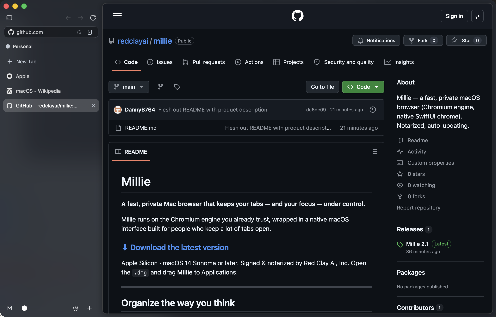

# Millie

**A fast, private Mac browser that keeps your tabs — and your focus — under control.**

Millie runs on the Chromium engine you already trust, wrapped in a native macOS interface built for people who keep a lot of tabs open.

### [⬇︎ Download the latest version](https://github.com/redclayai/millie/releases/latest)

Apple Silicon · macOS 14 Sonoma or later. Signed & notarized by Red Clay AI, Inc. Open the `.dmg` and drag **Millie** to Applications.

https://github.com/user-attachments/assets/fe9b30d7-ef4f-4c04-aeca-f21b305cf4c6

---

## Organize the way you think

- **Spaces** — keep Work, Personal, and side projects in separate sidebars, each with its own tabs, theme, and identity. Swipe between them with two fingers, or jump straight to one with ⌃1–9.
- **Profiles** — give each Space isolated storage: separate logins, cookies, history, and extensions. Sign into the same site twice without conflicts.
- **Smart folders** — group tabs into folders that show each site's icon at a glance.
- **Live folders** — folders that fill themselves from a source and refresh in the background: an RSS feed, or the open pull requests / issues on a GitHub repo. Your reading and your work queues, always current in the sidebar.
- **Tidy Tabs** — one click closes duplicates and groups the rest by site.
- **Site notes** — jot a note on any site from the address bar. It's filed by site, so it follows you across every page on that domain — running notes on a docs site, context on a dashboard, reminders on a client's app.

## Keep the tools you live in one click away

- **Web Panels** — pin the apps you keep coming back to — chat, music, a calendar, your notes — into a slide-in side panel that lives beside whatever you're reading. Right-click any tab and choose **Add to Web Panels**.
- **Previews** — hover a pinned site in the sidebar to glance at a live preview of the page — your calendar, inbox, or dashboard — without switching to it. It loads in your profile, so logged-in sites show real content.

## Bring your own agent

- Let your own **Claude Code** or **Codex** drive Millie right from the terminal — logins and all — to read your tabs and pages, open and navigate tabs, click, type, scroll, change settings, and tidy tabs into folders.
- It runs as a small **local MCP server** bound to your machine only (`127.0.0.1`) and protected by a token. Turn it on in **Settings → AI → Bring your own agent**, then paste the one-line command into Claude Code — Codex and other MCP clients use the same endpoint.
- Off by default, and every action still asks for your approval (with a one-tick "allow for this session" so a long run isn't a wall of dialogs). The token is a per-machine secret and is never synced.

## Built for power users

- Tear a tab out into its own window — just drag it past the edge.
- Split view for two pages side by side.
- A command bar (⌘T) to search, switch tabs, and run actions instantly.
- Most-recently-used ⌘-Tab switching with live tab previews.
- **Peek** any link in a floating overlay, then promote it into a full tab or a split when you want to keep it.
- **Super Copy** — copied links come out clean: tracking junk (`utm_*`, click IDs, share tokens) is stripped automatically.
- **Developer mode** — opt in and DevTools opens itself the moment a tab lands on a local dev server (`localhost`, `127.0.0.1`, `.localhost`, `.test`).
- Familiar Chrome keyboard shortcuts work out of the box — and a complete cheat sheet is one ⌘/ away.

## Private by default

- Built on Google Chromium.
- Built-in ad and tracker blocking.
- **Safe Browsing** — an offline blocklist warns you off known phishing and malware sites, with no telemetry.
- Per-profile isolation keeps your worlds apart.

## Everything you expect

- Chrome Web Store extensions (1Password, uBlock Origin, and more) — install them per profile or across all of them at once.
- Reader view, per-site **Boosts** (custom CSS/JS), link **Peek**, and **View Page Source** on any page.
- **Screenshots** — grab a region, or capture a whole scrolling page end to end — then **Share** straight to Mail, Messages, or AirDrop through the macOS share sheet.
- Tidy Picture-in-Picture, and **Keep Awake** to stop a tab from sleeping mid-task.
- Idle tabs sleep to save memory and archive themselves when stale.
- A built-in **AI assistant** that can read pages and help you get things done — bring your own key for Claude, GPT, or Gemini, or use the built-in local model.

## Always current

Millie updates itself automatically — security fixes included — so you're always on the latest. You can also check manually in **Settings → About → Check for Updates…**.

---

Millie is built on the Chromium open-source project. © Red Clay AI, Inc.
